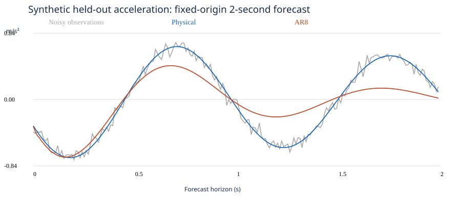

# Physics-Informed Modeling Under Uncertainty

**Standalone synthetic methodological demonstration. No KUKA measurements, private research code or empirical robot validation.**

## Question and assumptions

Can a correct dynamics model still give unreliable forecasts when the sensor observation model changes?

A small torsional oscillator satisfies

\[\ddot\theta+2\zeta\omega\dot\theta+\omega^2\theta=0,\quad\theta(0)=A,\quad\dot\theta(0)=0.\]

This is an idealized, unforced, linear rotational spring–damper. An ideal single-axis sensor observes the **linearized tangential** acceleration:

\[y(t)=r\cos\phi\,\ddot\theta(t)+\epsilon(t)=\beta q(t;\omega,\zeta)+\epsilon(t),\quad\beta=rA\cos\phi.\]

Here q is the unit-initial-angle angular acceleration. The small-angle sensor model neglects centripetal terms, gravity, changing projection during motion and real hardware filtering. It is not a full accelerometer model. Noise is independent Gaussian with SD 0.05 m/s². Radius is 0.5 m, initial angle 0.1 rad, frequency 6 rad/s, damping ratio 0.03 and projection angle 30 degrees.

## Reproduce

Use Python 3.12 or newer in a fresh virtual environment. From this directory:

```sh
python -m pip install -r requirements.txt
python -m unittest -v test_demo
python demo.py --output .
```

No downloads of research data, credentials or network calls occur in the demonstration. Output is a JSON record and an SVG figure. Exact tested versions are pinned; runtime versions appear in JSON.

## Method

- Numerical ODE simulation at 100 Hz over 6 seconds; an independent closed-form response supplies the fitting model.
- Train on 0–3.99 seconds. Forecast 4–5.99 seconds from a single origin, with **no test observations used for state updates or parameter estimation**.
- Estimate frequency, damping and projected amplitude with bounded nonlinear least squares and three training-ranked starts. Under the stipulated independent constant-variance Gaussian error this is an MLE objective; no posterior or credible interval is computed.
- Compare a fixed AR8 with intercept, zero prediction and persistence on exactly the same 200 future observations. AR8 is deliberately a simple baseline, not an optimized representative of all statistical methods. The physical model receives the correct model family and initial-velocity constraint; the comparison does not isolate a universal benefit of physics.
- Repeat using seeds 0–19 without selecting favourable runs. Seed 2026 is the predeclared illustrated case. These are noise repetitions of one mechanism, not independent robots, confidence intervals or a statistical power study.
- In a separate stress case, change only the observation projection to 60 degrees at the test boundary; keep forecasts frozen. This represents an idealized instantaneous remount, not damage.

## Results from the recorded run

| Forecast | Stationary RMSE (m/s²) | Changed projection RMSE (m/s²) |
|---|---:|---:|
| Physical | 0.05352 | 0.21137 |
| AR8 | 0.22929 | 0.15014 |
| Zero | 0.46132 | 0.26695 |
| Persistence | 0.56572 | 0.42753 |

Estimated omega = 5.99909 rad/s, zeta = 0.0301935 and beta = 0.0436525 m. ODE/analytical acceleration agreement: maximum absolute error 2.38e-9 m/s². Full per-seed results are in `results.json`; the table reports only seed 2026. Across the 20 fixed noise seeds, mean RMSE was 0.04992 (physical) versus 0.23456 (AR8) in the stationary case, and 0.20452 versus 0.12685 after the projection change. These averages are descriptive, not confidence bounds.



## Identifiability: what follows mathematically

For fixed omega, zeta and nonzero q, identical beta implies identical noiseless observations. Conversely, identical observations at any sample with q nonzero imply identical beta. Thus, **within this stipulated model**, equality of noiseless signals is equivalent to equality of beta. It is not equivalent to equality of A and phi separately.

For known r, an independently known phi with cos(phi) nonzero is sufficient to recover A from beta. It is not necessary: another independent measurement or constraint could suffice. Predictive agreement alone is insufficient to identify the mounting angle.

The fitted beta implies A ≈ 0.08731, 0.10081 or 0.17461 rad if phi is assumed to be 0, 30 or 60 degrees. All three reproduce exactly the same fitted signal in this linearized observation model. These alternatives illustrate non-identifiability, not equally plausible calibrated physical states.

## What the demonstration does and does not establish

Five tests check ODE consistency, noiseless recovery, the amplitude–orientation ambiguity, an exact AR recurrence and absence of history mutation. They verify software/mathematics, not physical validity on a robot.

The nominal physical forecast is accurate under deliberately favourable assumptions. Changing the observation model reverses its advantage over this AR baseline in the illustrated case. Neither outcome establishes how either model performs on industrial data. Unknown forcing, coloured noise, model discrepancy, uncertainty intervals and independently held-out mechanisms remain future work.

Numerical tools: [SciPy solve_ivp](https://docs.scipy.org/doc/scipy/reference/generated/scipy.integrate.solve_ivp.html), [least_squares](https://docs.scipy.org/doc/scipy/reference/generated/scipy.optimize.least_squares.html), [NumPy least squares](https://numpy.org/doc/stable/reference/generated/numpy.linalg.lstsq.html).

Prepared for Mounir Belboualia's research portfolio, with AI-assisted implementation. No licence for the separate KUKA research archive is implied.
